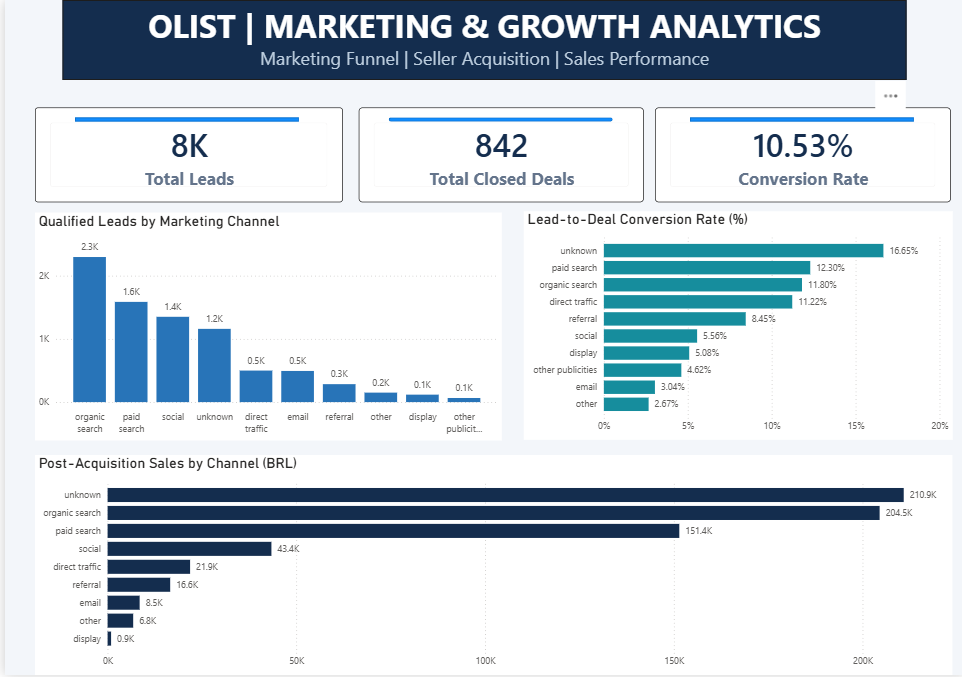
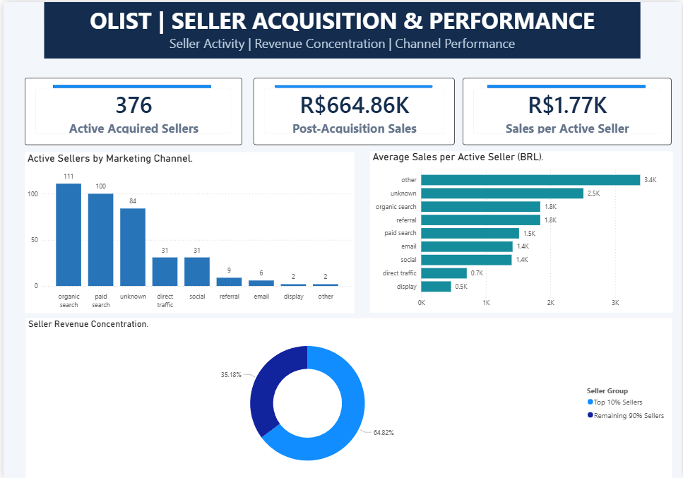

# Olist Marketing & Growth Analytics

**Marketing Funnel | Seller Acquisition | Sales Performance**

**Tech Stack:** SQL Server · Python (Pandas, NumPy, Matplotlib) · Excel · Power BI

## Project Overview

An end-to-end marketing and growth analytics project analyzing Olist's Brazilian e-commerce marketplace to understand how marketing channels generate qualified leads, convert them into acquired sellers, and contribute to post-acquisition sales.

The project integrates marketing funnel and e-commerce transaction datasets to translate raw data into business insights, performance dashboards, and actionable recommendations.

## Business Problem

An e-commerce marketplace needs to understand:

1. Which marketing channels generate the most qualified leads and closed deals?
2. Which acquisition channels bring sellers who subsequently generate sales?
3. How concentrated are sales among acquired sellers?
4. What improvements could strengthen acquisition performance and seller activation?

## Dataset & Scope

The analysis combines the **Olist Marketing Funnel** and **Brazilian E-Commerce** datasets.

Nine related datasets were imported into SQL Server, covering marketing leads, closed deals, sellers, orders, order items, customers, payments, products, and product category translations.

| Dataset Metric            | Records |
| ------------------------- | ------: |
| Marketing Qualified Leads |   8,000 |
| Closed Deals              |     842 |
| E-commerce Orders         |  99,441 |
| Order Items               | 112,650 |
| Marketplace Sellers       |   3,095 |

## Executive KPI Summary

| Key Performance Indicator                    |    Result |
| -------------------------------------------- | --------: |
| Total Qualified Leads                        |     8,000 |
| Total Closed Deals                           |       842 |
| Overall Conversion Rate                      |    10.53% |
| Acquired Sellers with Qualifying Sales       |       376 |
| Qualifying Post-Acquisition Product Sales    | R$664.86K |
| Average Sales per Active Acquired Seller     |   R$1.77K |
| Sales Share from Top \~10% of Active Sellers |    64.82% |

Post-acquisition sales represent product sales from delivered orders placed on or after the seller's first recorded deal-closing date, excluding freight.

## Power BI Dashboard

### Dashboard 1 — Marketing & Growth Overview

Visualizes marketing lead volume, closed deals, conversion rates, and post-acquisition sales across acquisition channels.

### Dashboard 2 — Seller Acquisition & Performance

Highlights active acquired sellers, sales per active seller, channel-level seller performance, and sales concentration.

## Key Business Insights

### 1. Organic Search leads identifiable acquisition volume

Organic Search generated **2,296 qualified leads and 271 closed deals**, achieving an 11.80% conversion rate. It was the largest identifiable acquisition source.

### 2. Paid Search demonstrates strong conversion efficiency

Paid Search achieved a **12.30% conversion rate**, compared with 5.56% for Social and 3.04% for Email.

These differences warrant further investigation into channel-level lead quality and sales follow-up effectiveness.

### 3. Missing channel attribution affects performance evaluation

The Unknown category contributed **1,159 leads and 193 closed deals**, with a 16.65% conversion rate.

Its substantial volume indicates that incomplete acquisition-source tracking could distort channel comparisons.

### 4. Seller sales are highly concentrated

Approximately **38 acquired sellers**, representing the top 10% of active acquired sellers, contributed **64.82%** of qualifying post-acquisition product sales.

This highlights dependence on a relatively small number of sellers.

### 5. Closed deals do not always translate into observable marketplace activity

Of 842 closed deals, **462 could not be matched** to sellers in the e-commerce seller dataset.

This reflects a limitation in matching dataset coverage and should not automatically be interpreted as seller inactivity.

## Business Recommendations

| Priority | Recommendation                                     | Business Objective                                           |
| -------- | -------------------------------------------------- | ------------------------------------------------------------ |
| 1        | Improve acquisition-source tracking                | Reduce unknown attribution and improve channel measurement   |
| 2        | Investigate conversion differences across channels | Identify opportunities to improve lead quality and follow-up |
| 3        | Strengthen seller onboarding and activation        | Help more acquired sellers generate sales                    |
| 4        | Monitor seller sales concentration                 | Understand dependence on high-performing sellers             |
| 5        | Improve acquisition-to-transaction tracking        | Measure seller activity after deal closure more reliably     |

These are evidence-informed recommendations; they have not been validated through controlled experiments.

## Technical Methodology

### SQL Server — Data Preparation & Analysis

- Imported nine datasets into SQL Server.
- Profiled missing values, duplicates, data types, and table relationships.
- Created cleaned tables while preserving legitimate missing and unmatched records.
- Performed six business analyses covering channel conversion, seller matching, post-acquisition sales, average seller sales, deal-closing time, and monthly lead-cohort trends.
- Created reusable SQL queries and reporting views.

### Python — Analytical Exploration

- Connected Jupyter Notebook to SQL Server using PyODBC.
- Used Pandas and NumPy for data manipulation and analytical calculations.
- Analyzed conversion patterns, seller performance, and sales concentration.
- Developed Matplotlib visualizations for acquisition performance and lead conversion trends.

### Excel — KPI Validation

- Cross-checked marketing KPIs against SQL and Python results.
- Verified 8,000 leads, 842 closed deals, and the 10.53% overall conversion rate.

### Power BI — Executive Reporting

- Built a relational reporting model.
- Developed two dashboard pages covering marketing performance and seller acquisition.
- Used KPI cards, channel comparisons, and seller sales concentration visuals.

## Repository Structure

| Folder                      | Contents                                                                |
| --------------------------- | ----------------------------------------------------------------------- |
| `01_SQL/`                   | Database setup, profiling, cleaning, business analysis, reporting views |
| `02_Python/`                | Jupyter notebook containing analysis and visualizations                 |
| `03_Excel/`                 | KPI validation workbook                                                 |
| `04_Documentation/`         | Project methodology, business insights and recommendations              |
| `05_Dashboard_Screenshots/` | Power BI dashboard screenshots                                          |

The raw datasets, local database backups, and Power BI Desktop file are not included in this repository.

## Analytical Limitations

- Advertising spend was unavailable, preventing reliable CAC, ROAS, and marketing profitability calculations.
- Post-acquisition sales are associated with acquired sellers; they do not establish incremental revenue caused by marketing.
- Dataset coverage differences affect seller matching and activity interpretation.
- The seller revenue concentration visualization represents a fixed historical calculation from Python, rather than a dynamically recalculated Power BI measure.

## Data Sources

- [Olist Marketing Funnel Dataset — Kaggle](https://www.kaggle.com/datasets/olistbr/marketing-funnel-olist)
- [Brazilian E-Commerce Public Dataset — Kaggle](https://www.kaggle.com/datasets/olistbr/brazilian-ecommerce)

## Project Outcome

This project demonstrates an end-to-end analytical workflow, from SQL data preparation and Python exploration to Excel validation and Power BI reporting.

The analysis identifies opportunities to improve marketing attribution, investigate conversion differences, strengthen seller activation, and monitor sales concentration.

---

**Ekansh Mathur**
Aspiring Data & Product Analyst | Delhi NCR, India

[GitHub Profile](https://github.com/ekanshmathur)
